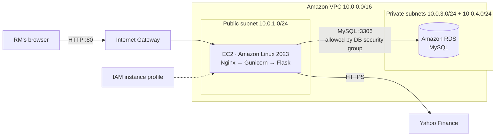

# Nimbus RM

**A web app for relationship managers to compare companies and keep track of client conversations — hosted on AWS.**

Group 1 project, extending the Nimbus case study. A relationship manager (RM) can compare two or more companies side by side, save a snapshot of each client discussion (price at the time, client interests, follow-up date), and look those records up later to prepare for the next conversation.


---

## Features

### Core (from the proposal)

| Feature | What the RM can do | Workshop link |
|---|---|---|
| **Compare companies** | Pick 2–5 tickers and see their price performance on one chart, rebased to 100 or in actual prices, over 1 month to 5 years | Lesson 4, Feature 2 |
| **Record discussion snapshots** | Save client ID, ticker, date, stock price at the time of discussion (fetched automatically), interest level, topic tags and notes | Lesson 4, Features 3 & 4 |
| **Retrieve records** | Find past discussions by client or by company, search notes, filter by date or interest, export to CSV | Stored in Amazon RDS |

### Advanced features

- **Financial ratios and trends** — revenue growth, gross and net margin, debt-to-equity, ROE, ROA and R&D intensity, calculated from each company's annual income statement and balance sheet and charted over the last 4–5 years.
- **Industry-specific comparison templates** — *General*, *Banking & Financials*, *Technology* and *Consumer & Retail*. Each template shows the metrics that matter for that sector (e.g. banks use ROE, ROA, price-to-book and equity-to-assets; debt-to-equity is left out because it is not meaningful for banks). The app suggests a template automatically from the companies' sectors.
- **Risk and diversification analytics** — annualised return, volatility, maximum drawdown and a correlation matrix of daily returns, so an RM can talk about risk and diversification, not just returns.
- **"Since discussion" tracking** — each client's history shows the price when you spoke and the change since then, a ready-made talking point for the follow-up call.
- **Follow-up reminders** — the dashboard lists follow-ups due in the next 14 days and flags overdue ones.
- **Multiple RMs with private books** — each RM logs in and sees only their own clients and records.
- **Resilient market data** — live data from Yahoo Finance via `yfinance`, cached for 15 minutes. If Yahoo is unavailable (it often rate-limits cloud servers), the app switches to clearly labelled demo data so a presentation never breaks.

---

## Architecture



| AWS service | How Nimbus RM uses it |
|---|---|
| **Amazon VPC** | Isolated network with two public and two private subnets across two Availability Zones. The public route table points to an Internet Gateway; the private route table has no internet route, so the database cannot be reached from outside. |
| **Amazon EC2** | `t3.micro` running Amazon Linux 2023. Nginx serves static files and forwards requests to Gunicorn, which runs the Flask app as a `systemd` service that restarts automatically. |
| **Amazon RDS** | MySQL database in the private subnets (not publicly accessible, storage encrypted, daily backups) holding users, clients and discussion snapshots. |
| **IAM** | The EC2 instance uses an instance profile (`LabInstanceProfile` in Learner Lab, or a least-privilege role the template creates with SSM + CloudWatch permissions). Team members should use their own IAM users rather than the root account. |
| **Security groups** | `nimbus-web-sg` allows HTTP (80) from anywhere and SSH (22) from an admin IP. `nimbus-db-sg` allows MySQL (3306) **only** from `nimbus-web-sg` — not from any IP address. |

All of this is defined as code in [`infra/nimbus-stack.yaml`](infra/nimbus-stack.yaml) (CloudFormation), and can also be built by hand in the console — see the [deployment guide](docs/DEPLOYMENT.md).

---

## Project structure

```
nimbus-rm/
├── app/
│   ├── __init__.py        # App factory, CSRF protection, template filters
│   ├── config.py          # Settings from environment variables (.env)
│   ├── models.py          # Database tables: users, clients, snapshots
│   ├── market.py          # Market data (Yahoo + demo), caching, analytics
│   ├── industry.py        # Industry comparison templates and metric definitions
│   ├── api.py             # JSON API used by the comparison page
│   ├── routes.py          # HTML pages: dashboard, clients, discussions
│   ├── auth.py            # Login, registration, logout
│   ├── cli.py             # flask init-db / create-user / seed-demo
│   ├── templates/         # Jinja2 HTML templates
│   └── static/            # CSS and the comparison page's JavaScript (Chart.js)
├── infra/nimbus-stack.yaml  # CloudFormation: VPC, subnets, SGs, RDS, IAM, EC2
├── deploy/
│   ├── setup_ec2.sh       # Installs and starts the app on EC2
│   ├── update.sh          # Pulls new code from GitHub and restarts
│   ├── nimbus.service     # systemd unit for Gunicorn
│   └── nginx.conf         # Nginx reverse-proxy config
├── docs/
│   ├── DEPLOYMENT.md      # Step-by-step AWS deployment guide
│   ├── schema.sql         # Database schema (for reference/report)
│   └── screenshots/
├── tests/                 # pytest suite (runs offline)
├── .github/workflows/ci.yml # Runs tests on every push
├── requirements.txt
├── .env.example
└── wsgi.py                # Entry point
```

---

## Run it on your laptop

Requires Python 3.10 or newer.

```bash
git clone https://github.com/<your-team>/nimbus-rm.git
cd nimbus-rm
python3 -m venv .venv
source .venv/bin/activate          # Windows: .venv\Scripts\activate
pip install -r requirements.txt
cp .env.example .env               # Windows: copy .env.example .env
```

Leave `DB_HOST` empty in `.env` and the app uses a local SQLite file, so you don't need MySQL locally.

```bash
flask --app wsgi seed-demo         # creates login demo / demo12345 with sample clients
flask --app wsgi run --debug
```

Open http://127.0.0.1:5000 and log in as **demo / demo12345**. Set `MARKET_DATA_PROVIDER=demo` in `.env` to work completely offline.

Other commands:

```bash
flask --app wsgi create-user alice "Alice Tan"   # prompts for a password
flask --app wsgi init-db                          # create tables
python -m pytest -q                               # run the tests
```

---

## Deploy to AWS

Full instructions, including the AWS Academy Learner Lab specifics, are in **[docs/DEPLOYMENT.md](docs/DEPLOYMENT.md)**. In short:

1. Push this repository to GitHub (public, so EC2 can clone it).
2. In the AWS console, open **CloudFormation → Create stack**, upload `infra/nimbus-stack.yaml`, and fill in the GitHub URL, a database password and a secret key.
3. Wait about 15 minutes, then open the `WebsiteURL` from the stack's **Outputs** tab.
4. SSH in once to create logins: `cd /opt/nimbus && sudo -u nimbus .venv/bin/flask --app wsgi seed-demo`.

To ship a code change: push to GitHub, then on the server run `sudo bash /opt/nimbus/deploy/update.sh`.

---

## Using the app

1. **Compare** — enter tickers such as `D05.SI, O39.SI, U11.SI` (Singapore stocks end in `.SI`) or click a preset. Switch the chart between *Rebased to 100* and *Actual price*, then scroll to the summary, correlation matrix, and the ratio charts. Change the **Industry template** to see different metrics.
2. **Save** — click *Save D05.SI @ 24.90* at the bottom of the comparison, pick or create a client, add notes, tags and a follow-up date.
3. **Retrieve** — open **Clients** to see a client's full history with the price change since each discussion, or **Discussions** to filter across all clients by company, interest, date or keywords, and export to CSV.

| Dashboard | Client history |
|---|---|
|  |  |

---

## Security measures

- Database in private subnets, `PubliclyAccessible: false`, reachable only from the web server's security group; storage encrypted at rest.
- Passwords hashed with Werkzeug (PBKDF2/scrypt); sessions signed with `SECRET_KEY`; cookies `HttpOnly` and `SameSite=Lax`.
- CSRF token on every form; all database access through SQLAlchemy (parameterised queries); ticker input validated against a strict pattern.
- Every record is scoped to the logged-in RM — another RM gets a 404 for records they don't own (covered by tests).
- Secrets live in `.env` (mode 600, owned by the service user) and are never committed (`.gitignore`).

## Limitations and next steps

- **HTTPS** — the app is served over HTTP. Next step: an Application Load Balancer with an AWS Certificate Manager certificate and a domain in Route 53.
- **Secrets** — the database password is passed as a CloudFormation parameter. In production it should come from AWS Secrets Manager.
- **Availability** — one EC2 instance and a single-AZ database. Next step: an Auto Scaling group across both public subnets behind the load balancer, and RDS Multi-AZ.
- **Market data** — Yahoo Finance via `yfinance` is free but unofficial and may be delayed or rate-limited. A bank would use a licensed feed (Bloomberg, Refinitiv).
- Statement data covers the last 4–5 fiscal years; some companies (especially banks) don't report every line item, so some ratios show "—".

*Market data is for discussion purposes only and is not investment advice.*
