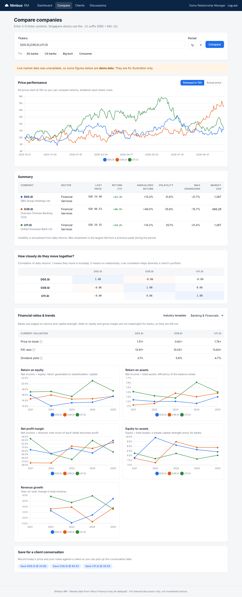
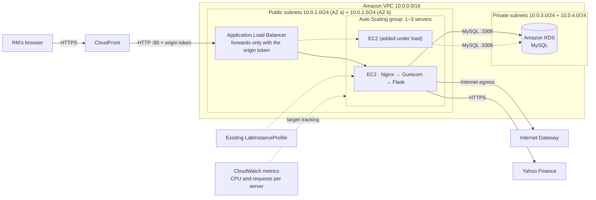
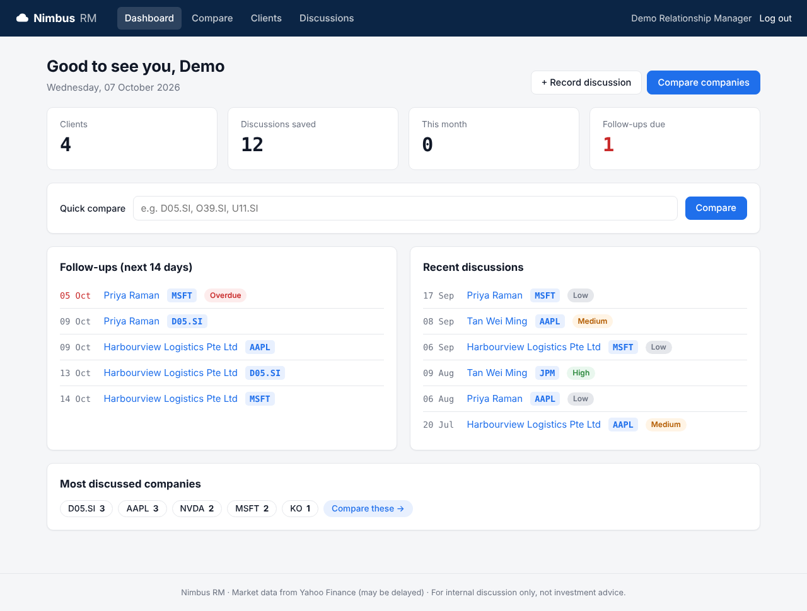
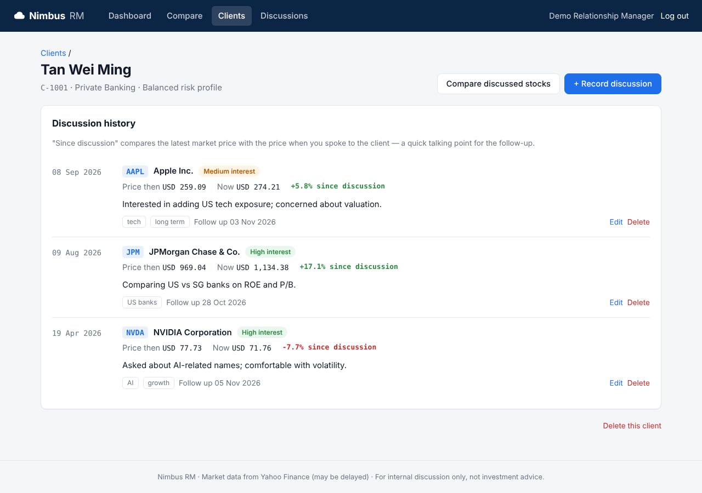

# Nimbus RM

**A web app for relationship managers to compare companies and keep track of client conversations — hosted on AWS.**

Group 1 project, extending the Nimbus case study. A relationship manager (RM) can analyse one company or compare up to five side by side, save a snapshot of each client discussion (price at the time, client interests, follow-up date), and look those records up later to prepare for the next conversation.



---

## Features

### Core (from the proposal)

| Feature | What the RM can do | Workshop link |
|---|---|---|
| **One-screen company briefing** | For each company on the Compare page: key financials for the latest fiscal year (revenue, net income, total debt, equity in M/B), a fixed core row of revenue growth, net margin and debt-to-equity (flagged as not meaningful for banks), Yahoo Finance analyst ratings and price targets, and recent news with publisher, date, link and the source's own summary ("No summary provided by the source" when there is none) | Lesson 4, Feature 1 |
| **Analyse or compare companies** | Pick 1–5 tickers (one company on its own, or several side by side) and see their price performance on one chart, rebased to 100 or in actual prices, over 1 month to 5 years | Lesson 4, Feature 2 |
| **Save a client discussion** | One **Save** on the Compare page stores the whole comparison for a client: every company's price at the time of discussion (with its date and source), revenue growth, net margin, debt-to-equity, the financials, ratings and news shown, plus the client's interests (required), notes and a follow-up date. Demo data is never saved as a client record | Lesson 4, Features 3 & 4 |
| **Search and reopen discussions** | **Discussions** page: search by client, by company (ticker or name) and by date, with SQL on the `discussions` and `discussion_companies` tables. **Open** shows the discussion read-only, exactly as saved, marked as a historical snapshot; it never fetches new market data | Lesson 4, Feature 5; stored in Amazon RDS |
| **Export and follow-ups** | Export saved discussions to CSV (one row per company, using the current search filters). The dashboard lists follow-ups due in the next 14 days and the most-discussed tickers, from saved discussions | Extra |
| **Stock notes** (secondary) | An optional quick note about one stock for a client (price then, interest level, tags, notes), with a "since discussion" price change, filters and CSV export. Saved discussions are the main record; stock notes are for a quick jotting without running a comparison | Extra |

### Advanced features

- **Financial ratios and trends** — revenue growth, gross and net margin, debt-to-equity, ROE, ROA and R&D intensity, calculated from each company's annual income statement and balance sheet and charted over the last 4–5 years.
- **Industry-specific comparison templates** — *General*, *Banking & Financials*, *Technology* and *Consumer & Retail*. Each template shows the metrics that matter for that sector (e.g. banks use ROE, ROA, price-to-book and equity-to-assets; debt-to-equity is left out because it is not meaningful for banks). The app suggests a template automatically from the companies' sectors.
- **Risk and diversification analytics** — annualised return, volatility, maximum drawdown and a correlation matrix of daily returns, so an RM can talk about risk and diversification, not just returns.
- **"Since discussion" tracking** — each client's history shows the price when you spoke and the change since then, a ready-made talking point for the follow-up call.
- **Follow-up reminders** — the dashboard lists follow-ups due in the next 14 days and flags overdue ones.
- **Multiple RMs with private books** — each RM logs in and sees only their own clients and records.
- **Honest market data** — live data from Yahoo Finance via `yfinance`, cached for 15 minutes. Every saved price records its source (*Yahoo Finance*, *Entered by RM* or *Demo data*). If Yahoo is unavailable, the app asks the RM to type the price instead of inventing one; demo data is used only when `MARKET_DATA_PROVIDER=demo` (offline work and tests) or, on the Compare page only, when `DEMO_FALLBACK=true`, and is always labelled. `DEMO_FALLBACK` is off by default and on AWS.

---

## Architecture



| AWS service | How Nimbus RM uses it |
|---|---|
| **Amazon CloudFront** | Public entry point with HTTPS from its default `cloudfront.net` certificate. Dynamic caching is disabled and session cookies/query parameters are forwarded. It adds a secret origin header to every request it sends to the load balancer. |
| **Application Load Balancer** | Spreads requests across the healthy servers in two Availability Zones and checks each server's `/api/health` (app and database) every 15 seconds. Its listener refuses (403) any request without CloudFront's secret header, so the servers cannot be reached directly. |
| **EC2 Auto Scaling** (Feature 6) | A launch template and an Auto Scaling group keep **1 to 3** servers running. Two **target-tracking** policies add a server when average CPU goes above 60% or requests per server go above the target, and remove servers when load falls. Unhealthy servers are replaced automatically. Changing the `GitCommit` parameter replaces the servers one at a time (rolling update) with no downtime and no data loss. |
| **Amazon VPC** | Two public subnets (load balancer and servers) and two private subnets (database), each pair in two Availability Zones. Public subnets route through an Internet Gateway; private subnets have no internet route. Security groups: internet → load balancer on 80; load balancer → servers on 80; servers → RDS on 3306. Nothing else. |
| **Amazon EC2 and EBS** | Each server runs Amazon Linux 2023 with Nginx and Gunicorn/Flask as a `systemd` service on an encrypted 8 GiB `gp2` root volume. Servers need outbound internet for installation and Yahoo Finance; a NAT gateway is avoided to reduce sandbox cost. The footer shows which server answered and which commit it runs. |
| **Amazon RDS** | A 20 GiB, encrypted, single-AZ MySQL database in the private subnets holds users, clients, saved discussions (with their full snapshots) and stock notes. Because every saved discussion lives here, any server can reopen any discussion. Its endpoint is not public and its security group accepts MySQL only from the servers' security group. |
| **Amazon S3** | A private, encrypted archive bucket stores saved discussions (with their full snapshot) and stock notes whose discussion date is older than five years, each verified after upload before it is removed from RDS; objects transition to Glacier Flexible Retrieval after 30 days. Every server has the monthly timer, but a database lock lets only one run it. |
| **IAM** | The servers use the sandbox's existing `LabInstanceProfile` for Systems Manager and S3 archive access. The sandbox does not allow creating IAM roles or policies. |
| **AWS CloudFormation** | Creates the whole environment as one stack from [`infra/nimbus-merged-stack.yaml`](infra/nimbus-merged-stack.yaml), so it can be rebuilt the same way every time. The stack only reports success after a server has installed the app and signalled that it is healthy. |

The deployment is defined in [`infra/nimbus-merged-stack.yaml`](infra/nimbus-merged-stack.yaml). Its architecture, setup steps, resource rationales and limitations are documented in the [CloudFront sandbox guide](docs/CLOUDFRONT_SANDBOX.md), with the lab's full restrictions in [AWS Academy sandbox limitations](docs/AWS_ACADEMY_SANDBOX_LIMITATIONS.txt). Old discussion snapshots are archived monthly to a private S3 bucket and transitioned to Glacier Flexible Retrieval.

---

## Project structure

```
DS600-Group-Proj/
├── app/
│   ├── __init__.py        # App factory, CSRF protection, template filters
│   ├── config.py          # Settings from environment variables (.env)
│   ├── models.py          # Database tables: users, clients, discussions, discussion_companies, snapshots
│   ├── market.py          # Market data (Yahoo + demo), caching, analytics
│   ├── news.py            # News (ticker feed, search + RSS fallback, relevance filter) and analyst ratings
│   ├── industry.py        # Industry comparison templates and metric definitions
│   ├── api.py             # JSON API used by the comparison page
│   ├── discussions.py     # Save, search and reopen client discussions (Features 3–5)
│   ├── routes.py          # HTML pages: dashboard, clients, discussions
│   ├── auth.py            # Login, registration, logout
│   ├── cli.py             # flask init-db / create-user / seed-demo / archive-snapshots
│   ├── archive.py         # Verified export of old saved discussions and stock notes to S3
│   ├── templates/         # Jinja2 HTML templates
│   └── static/            # CSS and the comparison page's JavaScript (Chart.js)
├── infra/
│   └── nimbus-merged-stack.yaml # CloudFront → load balancer → Auto Scaling group → RDS, plus S3 archive
├── deploy/
│   ├── nginx-cloudfront.conf # Origin-token guard for the CloudFront deployment
│   ├── nginx-public.conf    # Optional direct-origin Nginx config
│   ├── setup_ec2.sh       # Installs and starts the app on EC2
│   ├── nimbus.service     # systemd unit for Gunicorn
│   ├── nimbus-archive.service # systemd service for snapshot archiving
│   └── nimbus-archive.timer # Monthly archive schedule
├── scripts/
│   └── load_test.py       # Sends load from a laptop to trigger auto scaling (evidence)
├── docs/
│   ├── CLOUDFRONT_SANDBOX.md # Sandbox deployment steps, rationale, considerations
│   ├── AWS_ACADEMY_SANDBOX_LIMITATIONS.txt # AWS Academy lab restrictions and access instructions
│   ├── schema.sql         # Database schema (for reference/report)
│   └── screenshots/
├── tests/                 # pytest suite (runs offline)
├── .github/workflows/ci.yml # Runs tests on every push
├── requirements.txt
├── .env.example
└── wsgi.py                # Entry point
```

---

## Run it on your laptop

Requires Python 3.10 or newer.

```bash
git clone https://github.com/pujoglekar2026/DS600-Group-Proj.git
cd DS600-Group-Proj
python3 -m venv .venv
source .venv/bin/activate          # Windows: .venv\Scripts\activate
pip install -r requirements.txt
cp .env.example .env               # Windows: copy .env.example .env
```

Leave `DB_HOST` empty in `.env` and the app uses a local SQLite file, so you don't need MySQL locally.

```bash
flask --app wsgi seed-demo         # creates login demo / demo12345 with sample clients
flask --app wsgi run --debug
```

Open http://127.0.0.1:5000 and log in as **demo / demo12345**. Set `MARKET_DATA_PROVIDER=demo` in `.env` to work completely offline.

Other commands:

```bash
flask --app wsgi create-user alice "Alice Tan"   # prompts for a password
flask --app wsgi init-db                          # create tables
python -m pytest -q                               # run the tests
```

---

## Deploy to AWS

For the full AWS Academy sandbox steps, follow **[docs/CLOUDFRONT_SANDBOX.md](docs/CLOUDFRONT_SANDBOX.md)**. In short:

1. Make sure the commit you want to deploy is on GitHub (the repository must be public so the servers can clone it), and copy its hash: `git rev-parse HEAD`.
2. In **us-east-1**, create a CloudFormation stack from `infra/nimbus-merged-stack.yaml`. Enter the repository URL, the **GitCommit** hash, and generated secrets.
3. Wait for the stack to reach `CREATE_COMPLETE` (about 20–25 minutes, mostly the database and CloudFront), then open the `ApplicationURL` output. Register a login on the app's Register page.

**To deploy new code:** on the stack choose **Update → Use current template**, change only **GitCommit**, and submit. The Auto Scaling group starts a server with the new commit, waits for it to report healthy, then removes an old one. The site stays up and the database is untouched. The footer shows the new commit when it is done.

**Do not delete the stack to redeploy:** deleting it deletes the database and every saved discussion.

---

## Using the app

This is also Gaurav's acceptance test, in order:

1. **Compare** — enter one ticker, or up to five, such as `AAPL, MSFT` or `D05.SI, O39.SI, U11.SI` (Singapore stocks end in `.SI`), or click a preset. You see price performance side by side (rebased to 100 or actual prices), then **Financials, ratings & news**: revenue growth, net margin and debt-to-equity, analyst ratings, and news with its source. Open **Financial ratios & trends** for year-by-year charts and industry templates.
2. **Save** — at the bottom, under **Save this discussion**, choose a client (or add a new one with its client ID), set the discussion date, enter the **client interests** (required) and any notes or follow-up date, and click **Save discussion**. The whole comparison is stored. The page sends back exactly the figures it showed, with a tamper-proof signature from the server, so the record matches the screen even when a different server handles the Save; one click is stored once, even if the request is repeated.
3. **Search** — open **Discussions** and search by client, by company (ticker such as `MSFT`, or a name such as `apple`) or by date. A client's page also lists their saved discussions.
4. **Reopen** — click **Open**. The page shows the discussion exactly as saved (prices, ratios, financials, ratings and news), marked *Historical snapshot*. Nothing is fetched again; use *Compare again with today's data* to see current figures.
5. **Export** — on **Discussions**, **Export CSV** downloads the saved discussions matching the current search (one row per company).
6. **Stock notes** (optional) — a quick note about a single stock without running a comparison, with the price change since that discussion.

| Dashboard | Client history |
|---|---|
|  |  |

---

## Security measures

- Database in private subnets, `PubliclyAccessible: false`, reachable only from the web server's security group; storage encrypted at rest.
- Passwords hashed with Werkzeug (PBKDF2/scrypt); sessions signed with `SECRET_KEY`; cookies `HttpOnly` and `SameSite=Lax`.
- CSRF token on every form; all database access through SQLAlchemy (parameterised queries); ticker input validated against a strict pattern.
- Every record is scoped to the logged-in RM — another RM gets a 404 for records they don't own (covered by tests).
- Secrets live in `.env` (mode 600, owned by the service user) and are never committed (`.gitignore`).

## Limitations and next steps

- **HTTPS** — CloudFront serves HTTPS with its default certificate; the hop from CloudFront to the load balancer is HTTP inside AWS, protected by the secret origin header. A custom domain with an AWS Certificate Manager certificate is not possible in the sandbox.
- **Secrets** — the database password is passed as a CloudFormation parameter. In production it should come from AWS Secrets Manager.
- **Sandbox resets** — the AWS Academy sandbox deletes every resource, including the database, when the session ends. The stack is created fresh at the start of each session (about 15 minutes), so saved discussions last only for that session. In a normal AWS account they would persist.
- **Availability** — the servers scale across two Availability Zones, but the database is single-AZ (the sandbox does not support RDS Multi-AZ) and is deleted with the stack.
- **Scaling speed** — a new server takes about 6–9 minutes to install the app, and target tracking removes servers only after about 15 minutes of low load, so scaling is visible in minutes, not seconds.
- **Per-server memory** — each server caches market data for 15 minutes in its own memory, so two servers can show slightly different prices for the same company at the same moment. A saved discussion always stores the figures the RM actually saw (the page sends them back, signed), and lives in RDS.
- **Market data** — Yahoo Finance via `yfinance` is free but unofficial and may be delayed or rate-limited. A bank would use a licensed feed (Bloomberg, Refinitiv).
- **News** — Yahoo's ticker news feed sometimes returns nothing; Nimbus then uses Yahoo search (only articles linked to the ticker that name the company) and Yahoo's RSS headline feed. RSS items have no publisher, and many search items have no summary; the page says so rather than writing one. In demo data mode no news or analyst ratings are shown at all.
- Statement data covers the last 4–5 fiscal years; some companies (especially banks) don't report every line item, so some ratios show "—".

*Market data is for discussion purposes only and is not investment advice.*
